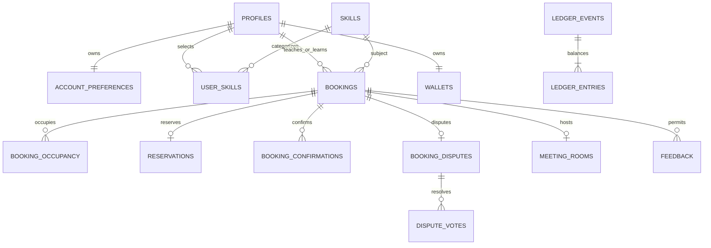

# Database schema and future design

Phase 3 implements `profiles`, `account_preferences`, and `save_my_profile` through `supabase/migrations/20261010160000_auth_profiles.sql`, initially applied to local Supabase. Phase 4 implements `skills`, `user_skills`, `replace_my_skills` and `discover_members` through `20261010180000_skills_matching.sql`, initially applied locally. Phase 5 adds `public.bookings`, `private.booking_occupancy`, `private.booking_idempotency` and restricted booking routines through `20261010190000_scheduling_bookings.sql`. Phase 6 implements financial tables/routines through `20261010200000_credits_completion.sql`; Phase 7 adds demo mapping/rate routines. Earlier migrations were initially local-only; all seven files are now applied to the new hosted SkillSwap project. MVP defaults are recorded in `PROJECT_SPEC.md`. Implement tables incrementally in `supabase/migrations/`; never run migrations against an existing remote project without owner authorization.

## Tables and relationships

Use UUID primary keys, `timestamptz` UTC timestamps, explicit foreign keys and check constraints. Supabase `auth.users` supplies identity/passwords. `public` tables are exposed with RLS; `private` is excluded from PostgREST's exposed schemas. Privileged functions have a fixed safe search path and schema-qualified references.

| Table / phase | Fields and constraints | Visibility / writes |
| --- | --- | --- |
| `public.profiles` / 3 | `id` PK/FK auth user, `display_name` 2–60, `bio` ≤500, `college` ≤120, `onboarded_at`, timestamps | Authenticated members read onboarded safe profiles, profiles exist only after verified onboarding; members write their own safe fields only via `save_my_profile`; no direct mutation or member deletes |
| `public.account_preferences` / 3 | `user_id` PK/FK, validated IANA `timezone`, timestamps | Self read; atomic writes via `save_my_profile`; no public email or timezone preference |
| `public.skills` / 4 | `id`, unique `slug`, `name`, `category`, `enabled` | Members read enabled skills; historical booking references are future design; migration-controlled writes |
| `public.user_skills` / 4 | `(user_id, skill_id, direction)` composite PK; direction offered/wanted; FKs | Members read onboarded members' selections; self writes through validated replacement operation, max 20 per direction |
| `public.bookings` / 5–6 | `id`, teacher/learner FKs (different), skill FK, `starts_at`, derived `ends_at`, duration 30/60/90, state, cost units = duration, `request_expires_at`, timestamps | Participants read; only trusted functions write; no client-controlled financial fields |
| `private.booking_occupancy` / 5 | `(booking_id, user_id)` PK; exactly two rows per active booking; `during` `tstzrange` `[)`; FK to profiles/bookings | No direct client access; maintained by booking functions |
| `public.wallets` / 6 | `user_id` PK/FK, `settled_units bigint` ≥0, `reserved_units bigint` between 0 and settled | Self read; trusted finance functions write; available = settled − reserved |
| `public.reservations` / 6 | `booking_id` PK/FK, learner FK, units >0 equal booking cost, status held/released/settled, timestamps | Booking participants read (wallet list filtered to self learner); trusted functions write |
| `private.ledger_events` / 6 | `id`, kind starter_grant/session_transfer, nullable booking FK unique for transfer, nullable beneficiary FK unique for starter grant, timestamps | No direct client access; immutable trusted writes |
| `public.ledger_entries` / 6 | `id`, event FK, nullable user FK (null = issuance system account), signed nonzero units, created_at; unique event/account including null account | Self reads their own entries; immutable trusted writes; system account never exposed |
| `public.booking_confirmations` / 6 | `(booking_id, user_id)` PK, confirmed_at; participant-only and after end | Participants read; trusted functions insert; no client direct writes/updates/deletes |
| `public.booking_disputes` / 6 | `booking_id` PK/FK, opened_by participant FK, reason 10–500, opened_at, resolved_at | Participants read; trusted functions write |
| `public.dispute_votes` / 6 | `(booking_id, user_id)` PK, resolution complete/cancel, updated_at | Participants read; trusted functions upsert while disputed |
| `private.meeting_rooms` / 7 | `booking_id` PK/FK, provider identifier, unique room reference, timestamps | No client access; server operations expose short-lived tokens only |
| `public.feedback` / 8 | `id`, booking FK, reviewer/reviewee FKs different, rating 1–5, plain-text comment ≤500, created_at; unique `(booking_id, reviewer_id)` | Authenticated members read published feedback; trusted eligible insert; immutable for MVP |
| `private.idempotency_records` / 5–8 | Actor FK, operation, resource key, UUID request key composite unique; normalized request/result JSON and created_at | No direct client access; same transaction as mutation |

Use restrictive deletion semantics for identity and financial references; account deletion must not cascade away audit history. The four Phase 3–4 tables, public bookings and two private scheduling tables are present. Financial DTOs require bigint-to-safe-integer conversion with explicit range checks at the API boundary. MVP amounts are tiny, but do not silently cast arbitrary 64-bit values into imprecise JavaScript numbers.

## Relationships

Each booking has exactly one teacher and learner; diagram's combined relationship does not imply a global account role. Wallets and preferences are provisioned through their phase-specific onboarding operations; optional during earlier phases.

## Scheduling invariants and transaction order

A check per role in `bookings` cannot prevent a person teaching one session while learning an overlapping one. Use two occupancy rows and a GiST exclusion constraint on `(user_id WITH =, during WITH &&)`, using `btree_gist` for UUID equality. This catches cross-role and concurrent conflicts. Adjacent `[start,end)` intervals do not overlap. Functions/triggers validate occupancy corresponds exactly to the two participants, start/end and active states. Terminal bookings remove occupancy transactionally; disputes keep original time range.

All booking operations take transaction-scoped participant locks in sorted UUID order. Phase 5 additionally serializes all scheduling routines with one advisory transaction lock before participant row locks and scoped expiry. A future higher-throughput implementation should determine the whole affected participant set, lock it in sorted order, then re-read/retry if it changed. Locking arbitrary subsets and later acquiring more participants out of order can deadlock. Use a bounded transaction and a safe retry on deadlock/serialization failure, never retry a non-idempotent external provider operation blindly.

Inside a mutation: establish authorized actor → lock participants → expire relevant overdue pending requests with reservation release → lock relevant wallets in the same order → validate current state/timing/skill/funds → insert/update booking + occupancy + reservation → append financial event if needed → store idempotency result → commit. Expiry paths may need wallets; use the same order everywhere. Never call an external video service while holding database locks.

Pending expiry derives from database time; acceptance and expiry serialize on the same booking/participant locks. If cleanup expires a request and an attempted action is invalid, commit cleanup and return a typed conflict outcome rather than rolling it back via an exception. Reads needing authoritative wallet/bookings run the scoped expiry routine before selecting. A later optional scheduled sweep is not the only correctness mechanism.

## Financial invariants

One credit = 60 units, not a float. Every starter or transfer event has a balanced pair of immutable entries summing to zero. Starter grant posts −180 to a distinguished issuance account (null user) and +180 to the verified member; only the issuance account may be negative. Each user wallet equals the sum of their posted entries; reserved equals their held reservations. Add a reconciliation query/test for both invariants. The system account is represented by ledger entries, not an ordinary member wallet.

Use event checks: starter has one nonnull beneficiary and no booking, unique beneficiary; transfer has exactly one booking and no grant beneficiary, unique booking. Partial unique indexes encode these conditions. Use a unique event/account index that treats null accounts as equal, preventing duplicate system entries. Deferred constraint triggers validate two entries, correct actors and amounts, and zero event sum at commit. Ledger entries and events cannot be updated/deleted by API roles; administrative maintenance is a separately authorized operation.

- Grant: verified identity + first onboarding trigger/function inserts unique starter event, pair and wallet credit in one transaction. Repeat onboarding updates cannot mint another grant. Phase 3 may create profiles before Phase 6; Phase 6 uses a one-time eligible-account backfill or lazy grant with the same unique key, never a repeatable unguarded migration update.
- Reserve: lock learner wallet, require available ≥cost; increment reserved and create held reservation with booking. Settled total and ledger unchanged.
- Release: lock wallet/reservation, transition held→released once, decrement reserved. Reject/expire/cancel share this operation. No posted credit transfer for released holds.
- Complete: lock participants/wallets/reservation, require accepted with both eligible confirmations or disputed with both matching complete votes after end. Insert unique transfer event, learner −cost and teacher +cost; decrement learner reserved and settled, increment teacher settled; mark reservation settled and booking completed in the same transaction.
- Dispute cancellation: both matching cancel votes release held reservation and mark cancelled once. A first complete vote does not settle.

Enforce `0 <= reserved <= settled` for member wallets and equality between cost/duration/reservation units. Database functions take no client balances or completion flags. Unique constraints protect against replay keys changing. Transaction rollback leaves no partial ledger, wallet, booking, or reservation change.

## Authorization and RLS

Enable RLS on every public application table before granting access. No permissive anonymous policies. Privileged DB roles bypassing RLS cannot be used from the browser. Service-role credentials, if required for video room provisioning, remain server-only with explicit participant authorization before use.

- Profiles: authenticated read limited to onboarded safe fields plus own draft. Owner insert/update checks both existing and resulting owner; field-level grants/trusted profile function prevent edits to onboarding eligibility or internal timestamps. No stored balance/reputation fields in the public profile.
- Preferences: `auth.uid() = user_id` for select/write. User cannot choose another owner.
- Skills: authenticated controlled read; ordinary users have no catalogue mutation permission.
- User skills: owner writes, onboarded safe read; use a trusted replacement function plus revoked direct write grants to enforce catalogue validity and count caps atomically.
- Bookings and related participant data: `auth.uid()` equals teacher or learner through booking membership. Mutations are revoked from API roles and executed only by narrowly scoped trusted functions.
- Wallets: owner select only. Ledger entries: nonnull `user_id = auth.uid()` select only; system entries invisible. No owner update privileges on financial tables.
- Feedback: authenticated select; insert only via a function deriving the other participant from a completed booking. No ordinary update/delete.
- Private schema: no browser grants or exposed-schema access. Idempotency results are returned only to their verified actor after checking access.

Security-definer functions must read `auth.uid()` themselves, reject null actor IDs, enforce verification/onboarding where required, validate all parameters, schema-qualify objects, use a fixed safe search path, revoke default PUBLIC/anonymous execution, and grant execution only to intended roles. Never accept a purported actor ID in place of the validated database identity. Internal helpers have no direct authenticated execute grant. Use database-trigger invariants as defense in depth, not substitute authorization.

Reputation: derive average/count only from immutable eligible feedback. A security-invoker view can expose aggregates with underlying authenticated read policies; never use a broad definer view that bypasses RLS. No rating means null average and zero count. Leaderboard threshold/order follow the adopted specification.

## Indexes and implementation checks

Index booking teacher/start, learner/start, state/expiry; skill direction/skill/user for discovery; reservation learner/status; ledger user/created/id; feedback reviewee/created/id. Add indexes on RLS lookup FK columns and verify query plans with representative data later.

Later DB tests must cover anonymous and wrong-owner access, direct mutation denial, malicious actor IDs, missing onboarding/email verification, cross-role and concurrent overlaps, zero/negative/invalid amounts, concurrent insufficient-credit bookings, duplicate grants/transfers, accept-versus-expire/cancel races, one-sided completion, dispute resolution races, and feedback before completion. Check ledger conservation, wallet reconciliation and reservation sums after every financial scenario. Phase 3 integration tests exercised local PostgreSQL/Auth: anonymous reads/RPC denied, cross-user direct updates denied, owner saves persisted, other-user preferences hidden, invalid timezone RPC rejected atomically. Phase 6 financial tables and local tests are implemented; phase-specific evidence is below.

## Phase 3 implementation details

Profiles are created on first verified onboarding, not at signup. `save_my_profile` takes only safe fields, derives `auth.uid()`, checks `auth.users.email_confirmed_at`, validates all values including `pg_timezone_names`, and upserts both tables in one transaction. Onboarding/creation timestamps remain fixed on edits. All ordinary direct writes are revoked, including own updates; the function has a fixed empty search path and explicit execute grants to authenticated members only. RLS permits member profile reads and owner-only preferences. No starter grant or reputation database exists yet. Backend schema types match this migration; regenerate after authorized schema changes.

## Implemented Phase 4 permissions and matching

The migration inserts 12 stable catalogue entries (programming, creative, music, communication, academic and productivity). Authenticated roles have SELECT only; anonymous roles have no table or function access. User selections reference onboarded profiles; members may read selections, but no ordinary member has direct INSERT/UPDATE/DELETE grants on either new table.

`replace_my_skills` is a restricted security-definer function with an empty search path, derived `auth.uid()`, authoritative verified-email check and profile row lock. It rejects null arrays/elements, duplicates, more than 20 IDs per direction, unknown or disabled skills before deleting anything. It atomically replaces both lists and accepts empty arrays. Concurrent saves result in one complete selection, never a mixed set.

`discover_members` is a security-invoker function with an empty search path and no actor argument. It requires onboarding, checks the optional filter against the caller's enabled wanted skills, joins wanted-to-offered IDs, excludes self and disabled skills, aggregates explanations in slug order, and pages in member UUID order. Only safe profile fields are returned; preferences/email stay private. Its maximum internal limit is 51 (50 plus one lookahead row). Local integration checks cover direct mutation denial, injected ownership, invalid atomic rollback, concurrency, explained matching and pagination.

## Implemented Phase 5 scheduling

`bookings` has restrictive participant/skill FKs, distinct-participant and duration checks, exact derived end/cost values, pending/accepted/rejected/cancelled/expired transitions, and an explicit `credit_reservation_status='not_integrated'` constraint. Future completed/disputed state names are reserved by the schema but no member function can set them yet. Authenticated roles have SELECT only with participant RLS; anonymous roles have no booking access. No exposed role can directly mutate bookings or either private table.

The `btree_gist` extension supports UUID equality in the occupancy exclusion constraint. Every new pending request inserts exactly two `[start,end)` occupancy rows in the same transaction; accepted requests retain them. Reject/cancel/expire removes rows atomically. Whole mutations are restricted security-definer functions with empty search paths, derived verified/onboarded actors, a global advisory transaction lock, UUID-ordered participant profile locks, authoritative time/offering checks, and GiST overlap enforcement. The global lock intentionally bounds MVP concurrency; do not claim load scalability.

Private idempotency stores successful normalized input/result per actor/operation/key. Creation same-key/different-input returns a typed conflict; successful retries return the original result. Participant/role checks still apply. Business conflicts are JSON outcomes so scoped expiry can commit even when HTTP returns 409. The overlap insert has a nested exception block that rolls back only the failed new booking, preserving expiry cleanup.

`read_my_bookings` performs scoped expiry and applies participant access and `(starts_at,id)` ordering; detail also returns server-derived permitted actions used only by the UI service. Direct table SELECT obeys RLS but does not perform expiry; authoritative app reads use the RPC. Phase 6 must add wallet/reservation/ledger/confirmation routines and require actual held funding for settlement. Preview bookings are never implicitly funded.

## Implemented Phase 6 finance

`wallets` stores exact bigint settled/reserved units, with nonnegative balances and reservation limits. `reservations` has one matching learner/amount/status per funded booking. Private `ledger_events` uniquely identify each beneficiary’s starter issuance and each booking’s transfer. Public `ledger_entries` contains two balanced, immutable entries per event; the issuance counterparty is a hidden null system account. `booking_confirmations`, `booking_disputes` and replaceable `booking_dispute_votes` record participant decisions.

Verified first onboarding inserts 180 units once; eligible existing profiles receive the same uniquely guarded backfill. New booking creation reserves credits and occupancy in one transaction; overlap failure rolls back both. Release never changes settled balances. Settlement inserts one unique event, debits learner and credits teacher, settles the reservation, completes the booking and removes occupancy atomically. Database functions derive actor and amounts, use empty search paths, global transaction serialization and ordered row locks. Ordinary roles cannot mutate these tables or execute private routines; owner/participant SELECT policies apply, and anonymous access is denied. Ledger entries/events reject UPDATE/DELETE even for service-role writes.

Deferred checks reconcile wallets with ledger sums and held reservations, require two entries summing to zero for each event, and verify funded booking/reservation agreement. Historical previews cannot have reservations or completed/disputed states. Completion requires both participants after end; disputes require agreement on completion or cancellation and retain funds indefinitely otherwise. Existing Phase 5 descriptions above are historical. This is an MVP correctness design; the global lock and reconciliation queries need redesign/index/performance review before high-volume usage.

## Implemented Phase 7 demo mapping

`private.meeting_rooms` stores a random stable room per booking; `private.meeting_rate_limits` stores a member’s window and count. Exposed roles have no table privileges. `meeting_access_context` derives a verified/onboarded actor, checks participation/state/held funds/time, serializes short updates using the existing advisory lock, and optionally consumes one bounded grant. A read-only context does not create a room or consume quota. Public Jitsi room names are not access tokens.

The initial private-video schema was applied before the owner selected public Jitsi. Its SQL is preserved; `20261010214500_jitsi_demo.sql` changes the provider and room generation without rewriting applied history. These migrations and the after-lock clock correction are applied locally and to the new hosted project. No provider call occurs under a DB lock, and meeting access never mutates wallets or financial states. Private-token/revocation design remains deferred under the explicit classroom-demo decision.

## Phase 8 deployed schema

`20261010230000_google_meet.sql` adds private `google_meet_links` (booking PK, canonical URL check, updated_at), denies member/anonymous table access and grants only the restricted `booking_meet_link` RPC. It derives the actor, serializes against booking transitions, enforces teacher-only edits, accepted funding, call-window expiry and participant-only reads. Jitsi rooms remain independent.

`20261010233000_feedback_reputation.sql` adds `public.feedback`: restrictive FKs to booking/reviewer/reviewee, different participants, integer 1–5, comment ≤500 and unique `(booking_id,reviewer_id)`. Member SELECT RLS supports published reviews; direct member INSERT/UPDATE/DELETE is revoked. The trigger independently requires a completed/settled, ended booking with the exact participant pair and rejects all updates/deletes. `create_feedback` derives identity/target and stores the idempotency result in the same transaction using the existing private booking-idempotency table. `20261010234000_feedback_actor.sql` qualifies its actor variable independently of the idempotency table column. Applied history is preserved.

`profile_reputation` is a read-only security-invoker aggregate view with member-only grants, average and rating count derived from eligible immutable feedback. No editable score fields exist. `community_leaderboard` is a security-invoker, authenticated-only bounded RPC, requiring ≥3 ratings and exact numeric/count/UUID ordering. Published reviewer/comment identity is separate from participant-only booking details and financial data. Reviews never update balances or grants.
